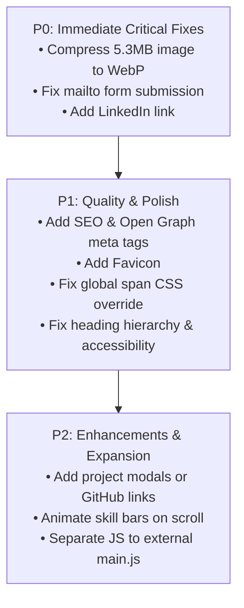

# Comprehensive Portfolio Audit & Technical Analysis

**Candidate / Portfolio Owner:** Santhoshgandhi M  
**Role:** .NET Developer & Backend/Full-Stack Specialist  
**Analysis Date:** November 2026  
**Document Status:** Complete & Actionable  

---

## 1. Executive Summary & Quality Scorecard

This document presents an exhaustive, 360-degree technical and qualitative evaluation of the personal portfolio website for **Santhoshgandhi M**. The portfolio presents a modern, dark-themed developer website targeted toward software engineering recruiters, hiring managers, and enterprise clients looking for C#, .NET Core, Blazor, and cloud-capable backend engineers.

### Evaluation Scorecard (Scale: 1–10)

| Category | Score | Rating | Summary |
| :--- | :---: | :---: | :--- |
| **Visual Design & Theming** | **8.5 / 10** | Very Good | Sleek dark glassmorphic palette, harmonious accent colors (indigo/sky blue/rose), smooth hover effects. |
| **Code Structure & Architecture** | **8.0 / 10** | Good | Pure vanilla HTML/CSS/JS with no bloated runtime dependencies. Well-structured CSS variables and clean classes. |
| **Content & Professional Story** | **8.5 / 10** | Very Good | Strong enterprise narrative emphasizing .NET, Blazor, SQL, RabbitMQ, and AI-assisted workflows. High-relevance project choices. |
| **Responsiveness & Cross-Device** | **8.0 / 10** | Good | Fluid grid layouts, well-defined media queries (1024px, 768px, 576px), and functional mobile hamburger navigation. |
| **Accessibility (WCAG 2.1 AA)** | **6.5 / 10** | Needs Attention | Good ARIA labels on icon buttons, but form inputs lack screen-reader labels and heading levels skip hierarchies. |
| **Page Performance & Assets** | **5.0 / 10** | **Critical Action Needed** | **5.3 MB uncompressed camera JPEG image** (`img/img.JPG`) creates severe mobile load latency and high data consumption. |
| **SEO & Social Sharing Preview** | **5.5 / 10** | Needs Attention | Lacks `<meta name="description">`, Open Graph (OG) tags, Twitter Card meta tags, and favicon links. |
| **Overall Readiness** | **7.4 / 10** | **Strong Foundation (Fix Performance & SEO)** | A visually appealing, professional portfolio that will become top-tier once assets are compressed and metadata is added. |

---

## 2. Project Architecture & File Hierarchy

The repository adheres to a lightweight static site structure:

```text
Portfolio/
├── .vscode/
│   └── launch.json                # VS Code Chrome debugging configuration (Port 8080)
├── css/
│   └── style.css                  # 1,041 lines of custom CSS styling & responsive queries
├── img/
│   ├── background.jpg             # Hero background overlay texture (459 KB)
│   ├── img.JPG                    # Profile photo used in "About" section (5.33 MB - CRITICAL)
│   └── img1.JPG                   # Secondary profile photo (5.41 MB - Unused orphan asset)
├── index.html                     # Main application markup & inline scripts (660 lines)
├── Santhosh Resume.pdf            # Direct download PDF resume (147 KB)
└── PORTFOLIO_ANALYSIS.md          # Complete technical analysis and roadmap (This document)
```

### Technology Stack Summary
- **Markup:** HTML5 (Semantic document outline)
- **Styling:** Vanilla CSS3 (Custom Properties / CSS Variables, CSS Grid, Flexbox, Glassmorphism)
- **Scripting:** Vanilla JavaScript ES6+ (IntersectionObserver, Typed Text Animation, Tab State Management, Mobile Nav Toggle)
- **External Dependencies:**
  - Google Fonts (`Outfit`: 300–800, `Inter`: 300–700)
  - Font Awesome 6.4.0 (CDN via cdnjs)

---

## 3. Deep-Dive Sectional Review

### 3.1. Header & Navigation (`index.html#L26-L44`)
- **Strengths:**
  - Sticky/fixed navigation header with backdrop blur (`backdrop-filter: blur(12px)`) that dynamically activates once scrolled past 50px.
  - Active section link tracking on scroll with CSS underline animation.
  - Mobile hamburger toggle with animated icon change (`fa-bars` to `fa-xmark`).
  - Auto-closing menu behavior when clicking a link on mobile.
- **Areas for Improvement:**
  - The anchor link for contact is `#Contact` with a capital `C`, while all others (`#home`, `#about`, `#skills`, `#experience`, `#projects`) use lowercase. In web development, consistent lowercase URI fragments are recommended to prevent case-sensitive routing glitches.

### 3.2. Hero Section (`index.html#L47-L65`)
- **Strengths:**
  - Impactful first impression with strong typography (`Outfit` font at 4rem).
  - Dynamic JavaScript typewriter effect alternating between roles: `".NET Developer"`, `"C# & Blazor Specialist"`, and `"AI-Assisted Developer"`.
  - Dual Call-to-Action (CTA): Direct "Download CV" linking to `Santhosh Resume.pdf` and "Let's Talk" smooth-scrolling to Contact.
  - Animated bouncing chevron down indicator pointing users to content below the fold.
- **Areas for Improvement:**
  - Heading order anomaly: Line 50 starts with an `<h4>` (*"Hello, my name is"*), followed by an `<h1>` (*"Santhoshgandhi M"*), followed by an `<h3>` (*"I'm a..."*). Screen readers and SEO crawlers prefer a logical descending order (`<h1>`, `<h2>`, `<p>`).

### 3.3. About Me Section (`index.html#L67-L125`)
- **Strengths:**
  - Highlighting 3+ years of experience in enterprise development (C#, ASP.NET Core, Blazor, SQL Server) and modern AI-assisted engineering.
  - Stylized photo frame with an offset bordered accent container (`.image-border`) that smoothly shifts on hover.
  - Clear 4-box quick information grid: Experience, Education (MCA 8.3 CGPA), Location (Coimbatore), and Direct Email.
- **Areas for Improvement:**
  - **Asset Weight:** The referenced profile image `img/img.JPG` is **5.33 MB**. On mobile networks, this can take 2–5 seconds to load, creating noticeable image pop-in and layout instability.

### 3.4. Skills Matrix & Interactive Tabs (`index.html#L127-L328`)
- **Strengths:**
  - Well-categorized skill taxonomy split into 4 distinct tabs:
    1. *Languages & Backend* (C# & .NET, ASP.NET Core, Python, ASP.NET MVC)
    2. *Frontend & UI* (Blazor, MudBlazor, HTML5 & CSS3, JavaScript)
    3. *Database & Cloud* (SQL Server, SQLite, AWS Lambda/Textract, Azure DevOps)
    4. *Tools & DevOps* (Git/GitHub, AI-Assisted Dev, RabbitMQ, EF Core / RBAC)
  - Interactive tab switcher with clean state transitions.
  - Visual progress bars with dual-color gradient fills.
- **Areas for Improvement:**
  - In technical hiring, percentage skill bars (e.g., "90% C#", "75% RabbitMQ") can be subjective. An alternative or companion view with proficiency badges, years of experience, or specific tools used in production is often preferred by engineering managers.

### 3.5. Professional Experience Section (`index.html#L330-L372`)
- **Strengths:**
  - Clean vertical timeline design with glowing indigo connector nodes.
  - Action-verb oriented bullet points emphasizing tangible technical contributions:
    - Blazor + MudBlazor + ASP.NET Core frontend/backend architecture.
    - Entity Framework Core transaction workflows and SQL Server optimization.
    - Asynchronous message brokering via RabbitMQ.
    - Role-Based Access Control (RBAC) security implementations.
    - Practical adoption of AI coding assistants for productivity, refactoring, and automated documentation.
- **Areas for Improvement:**
  - Currently displays only one position (ByVal Technologies, Jan 2023 – Present). If applicable, adding prior internships, notable collegiate achievements, or client consulting milestones provides richer chronological depth.

### 3.6. Relevant Projects Showcase (`index.html#L374-L478`)
- **Strengths:**
  - 5 well-delineated enterprise/system projects highlighting diverse problem domains:
    1. **WMS (Warehouse Management):** Real-time shipment/invoice compliance workflows in ASP.NET MVC.
    2. **B-Auth:** Centralized Blazor + MudBlazor role-based access management portal.
    3. **Blink:** Banking credit gateway integration with dynamic MudBlazor JSON configuration.
    4. **CAST:** Cash Accounting Studio migrated to serverless AWS Lambda and RabbitMQ.
    5. **C-Scan:** AI-powered OCR invoice extraction pipeline using Python, OpenCV, and Tesseract.
  - Clean technology tags (`project-tech`) on each card.
- **Areas for Improvement:**
  - None of the project cards feature links (e.g., GitHub repo, architecture write-up, live demo, or case study modal). Even if proprietary enterprise software cannot be shared publicly, adding an indicator like *"Internal Enterprise Solution"* or a *"Case Study"* modal explaining system architecture would elevate recruiter trust.

### 3.7. Contact Section (`index.html#L480-L509`)
- **Strengths:**
  - Direct display of contact phone number (`+91 96297 94110`) and email (`santhoshgandhim@gmail.com`).
  - Polished form layout with custom styled inputs, focus glow rings, and responsive 2-column to 1-column collapse.
- **Areas for Improvement:**
  - The form uses `action="mailto:santhoshgandhim@gmail.com" method="post" enctype="text/plain"`. Native HTML mailto forms are notoriously unreliable on modern browsers (often requiring a desktop email client like Outlook or failing silently on mobile). Replacing this with a free backend handler (e.g., Formspree, EmailJS, Web3Forms, or Netlify Forms) guarantees message delivery.

### 3.8. Footer & Socials (`index.html#L511-L522`)
- **Strengths:**
  - Minimalist layout with copyright and social links.
  - Circular icon buttons with hover glow and translateY animation.
- **Areas for Improvement:**
  - **LinkedIn is missing!** For a professional software engineer, LinkedIn is the #1 channel for recruiter outreach. Adding the LinkedIn profile icon is a top-priority fix.
  - Twitter rebranding: The link uses `twitter.com` with the legacy Twitter bird icon (`fa-brands fa-twitter`). Updating to `x-twitter` or adding LinkedIn/LeetCode/StackOverflow links is recommended.

---

## 4. Deep Technical Audit

### 4.1. Code Quality & Syntax Inspection

#### Issue 1: Global Span Style Collision
- **Location:** `css/style.css`, Line 67:
  ```css
  span {
      color: var(--accent-color);
  }
  ```
- **Risk:** This rule applies universally to every `<span>` on the entire page. While intended for colored logo accents (`Santhosh<span>gandhi</span>`), it forces child spans (like those in `.info-item span`, `.project-tech span`, and `.skill-name span`) to manually override their colors.
- **Remedy:** Scope this to a utility class or specific selectors:
  ```css
  .text-accent, .logo span, .section-title h2 span {
      color: var(--accent-color);
  }
  ```

#### Issue 2: Deprecated Scroll Property
- **Location:** `index.html`, Line 625:
  ```javascript
  if (pageYOffset >= (sectionTop - 250)) {
      current = section.getAttribute("id");
  }
  ```
- **Observation:** `pageYOffset` is deprecated in modern specifications; `window.scrollY` is standard (and is already used on line 614 of the same script).
- **Remedy:** Replace `pageYOffset` with `window.scrollY`.

#### Issue 3: Missing `<main>` Semantic Wrapper
- **Location:** `index.html`, Lines 47–509
- **Observation:** Sections (`#home`, `#about`, `#skills`, `#experience`, `#projects`, `#Contact`) sit directly inside `<body>` without an enclosing `<main>` element.
- **Remedy:** Wrap all content sections between `<header>` and `<footer>` inside `<main id="main-content">` to ensure full compliance with HTML5 semantic outlines.

---

### 4.2. Performance & Asset Weight Analysis

| Asset File | Current Size | Recommended Format & Size | Savings Potential |
| :--- | :---: | :---: | :---: |
| `img/img.JPG` (Profile) | **5,331 KB (5.33 MB)** | WebP / Compressed JPG (800x800px, ~120 KB) | **~97.7% reduction** |
| `img/img1.JPG` (Orphan) | **5,409 KB (5.41 MB)** | Remove or archive if unused | **100% (Clean up repo)** |
| `img/background.jpg` | **459 KB** | Compressed WebP (~120 KB) | **~74% reduction** |
| Fonts (Google CDN) | Distributed | Preconnect is already implemented (Good) | Optimized |
| Font Awesome (CDN) | ~75 KB | Good (Can also subset if desired) | Normal |

> [!CAUTION]
> **Performance Bottleneck:** Serving a 5.3 MB image as a 400px profile card wastes mobile bandwidth, dramatically harms Lighthouse performance metrics (specifically LCP - Largest Contentful Paint), and slows down initial rendering on cellular networks.

---

### 4.3. Accessibility (a11y) & Usability

1. **Heading Hierarchy:**
   - Current: `<h4>` -> `<h1>` -> `<h3>` in the Hero section.
   - Recommended: Use `<p class="hero-eyebrow">Hello, my name is</p>`, followed by `<h1>Santhosh<span>gandhi</span> M</h1>`, followed by `<h2>I'm a...</h2>`.
2. **Form Accessibility:**
   - The inputs on lines 500–504 have `placeholder` attributes but no corresponding `<label>` or `aria-label` elements. Screen reader users navigating by form controls may not have context on input expectations.
   - Adding `aria-label="Your Name"` and `aria-label="Email Address"` satisfies WCAG 2.1 Success Criterion 3.3.2.
3. **Contrast Compliance:**
   - Background: `#0b0f19` (Slate-950 equivalent).
   - Text colors: `#f8fafc` (high contrast ~17.5:1), `#94a3b8` (contrast ~7.1:1 on dark slate).
   - Both comfortably pass WCAG AAA for normal text contrast.

---

### 4.4. SEO & Social Meta Audit

The document currently contains only standard character encoding and viewport definitions:

```html
<meta charset="UTF-8">
<meta name="viewport" content="width=device-width, initial-scale=1.0">
<title>Santhoshgandhi M | .NET Developer Portfolio</title>
```

#### Missing SEO Elements:
- `<meta name="description" content="...">` — Essential for Google search snippets.
- `<meta name="keywords" content="...">`
- `<meta name="author" content="Santhoshgandhi M">`
- `<link rel="canonical" href="...">`
- `<link rel="icon" type="image/x-icon" href="...">` (Favicon missing)
- **Open Graph (OG) Tags:** When shared on LinkedIn, WhatsApp, or Slack, the link currently generates no preview thumbnail image or summary card.

---

## 5. Prioritized Action Plan & Roadmap



### Phase 1: High Priority (P0 - Immediate Fixes)
1. **Compress Images:** Resize and convert `img/img.JPG` to WebP format (max 800px width, quality 80), reducing file size from 5.33 MB to under 100 KB.
2. **Add LinkedIn Profile:** Insert LinkedIn icon link into both the About/Contact quick info and the footer.
3. **Connect Contact Form to an Active Endpoint:** Replace `mailto:` with Formspree, EmailJS, or Web3Forms.

### Phase 2: Medium Priority (P1 - Polish & Recruiter Conversion)
1. **Implement Complete SEO & Social Meta:** Add Open Graph and Twitter Card tags.
2. **Add Favicon:** Provide a `.ico` or SVG favicon for browser tabs.
3. **Refactor Global `span` CSS Rule:** Scope the color rule to avoid unintended inheritance.
4. **Accessible Form Labels:** Add `aria-label` or visually hidden labels to form inputs.

### Phase 3: Strategic Upgrades (P2 - Long-Term Value)
1. **Dynamic Progress Bar Animation:** Use `IntersectionObserver` to animate skill bars from 0% to target % when scrolled into view.
2. **Interactive Project Demos/Architecture Diagrams:** Provide pop-up modals or README links detailing problem statements, architectures, and outcomes.
3. **Separate Script File:** Extract inline JavaScript into `js/main.js` to facilitate browser caching and clean code separation.

---

## 6. Ready-to-Implement Code Enhancements

### 6.1. Recommended SEO & Open Graph Head Block
Add this block inside `<head>` in `index.html`:

```html
<!-- Primary Meta Tags -->
<title>Santhoshgandhi M | .NET Developer Portfolio</title>
<meta name="title" content="Santhoshgandhi M | .NET Developer Portfolio">
<meta name="description" content="Results-driven Software Developer with 3+ years of experience specializing in C#, ASP.NET Core, Blazor, SQL Server, and AI-assisted engineering.">
<meta name="keywords" content=".NET Developer, C#, ASP.NET Core, Blazor, MudBlazor, SQL Server, Software Engineer, Portfolio, Santhoshgandhi M">
<meta name="author" content="Santhoshgandhi M">
<link rel="icon" type="image/svg+xml" href="data:image/svg+xml,<svg xmlns='http://www.w3.org/2000/svg' viewBox='0 0 100 100'><text y='.9em' font-size='90'>💻</text></svg>">

<!-- Open Graph / Facebook / LinkedIn -->
<meta property="og:type" content="website">
<meta property="og:url" content="https://santhoshgandhi.dev/">
<meta property="og:title" content="Santhoshgandhi M | .NET Developer Portfolio">
<meta property="og:description" content="Explore enterprise .NET, Blazor, and cloud projects built by Santhoshgandhi M.">
<meta property="og:image" content="img/background.jpg">

<!-- Twitter -->
<meta property="twitter:card" content="summary_large_image">
<meta property="twitter:url" content="https://santhoshgandhi.dev/">
<meta property="twitter:title" content="Santhoshgandhi M | .NET Developer Portfolio">
<meta property="twitter:description" content="Explore enterprise .NET, Blazor, and cloud projects built by Santhoshgandhi M.">
<meta property="twitter:image" content="img/background.jpg">
```

### 6.2. Recommended Contact Form Fix
Replace the `<form action="mailto:...">` block with a working Web3Forms or Formspree endpoint:

```html
<form action="https://api.web3forms.com/submit" method="POST">
    <!-- Replace with your free Access Key from web3forms.com -->
    <input type="hidden" name="access_key" value="YOUR_ACCESS_KEY_HERE">
    <input type="hidden" name="subject" value="New Portfolio Contact Submission">
    
    <div class="form-row">
        <input type="text" name="name" placeholder="Your Name" aria-label="Your Name" required>
        <input type="email" name="email" placeholder="E-mail Address" aria-label="E-mail Address" required>
    </div>
    <input type="text" name="subject_line" placeholder="Write a subject" aria-label="Subject" required>
    <textarea name="message" rows="8" placeholder="Your Message" aria-label="Your Message" required></textarea>
    <button type="submit" class="btn btn-primary">Send Message</button>
</form>
```

### 6.3. Safe CSS Span Rule Refactoring
In `css/style.css`, replace line 67:

```css
/* Replace this:
span {
    color: var(--accent-color);
}
*/

/* With targeted selectors: */
.logo span,
.section-title h2 span,
.Contact-form h1 span,
.text-accent {
    color: var(--accent-color);
}
```

---

## 7. Conclusion

Santhoshgandhi M's portfolio features a strong, attractive dark-mode visual presentation with high-quality content targeting the modern .NET and AI-assisted engineering landscape. 

By executing the immediate optimizations outlined above—specifically **compressing the 5.3 MB image**, **upgrading the contact form handler**, and **adding LinkedIn and Open Graph tags**—this portfolio will achieve elite performance scores and maximized recruiter conversion.
